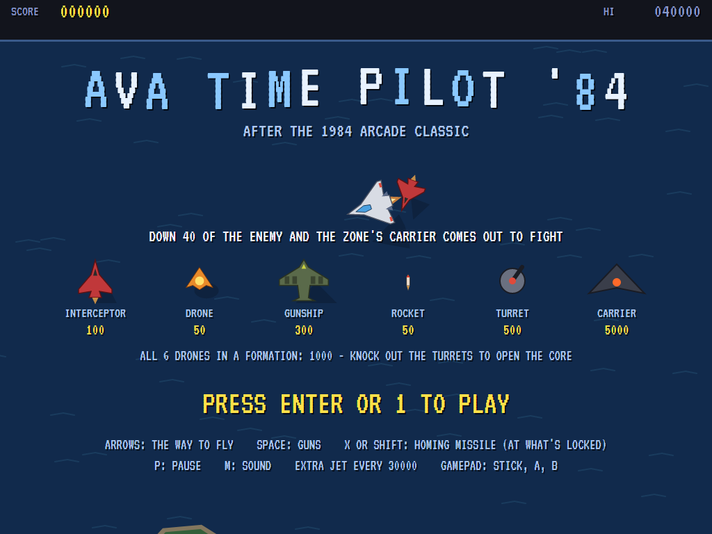
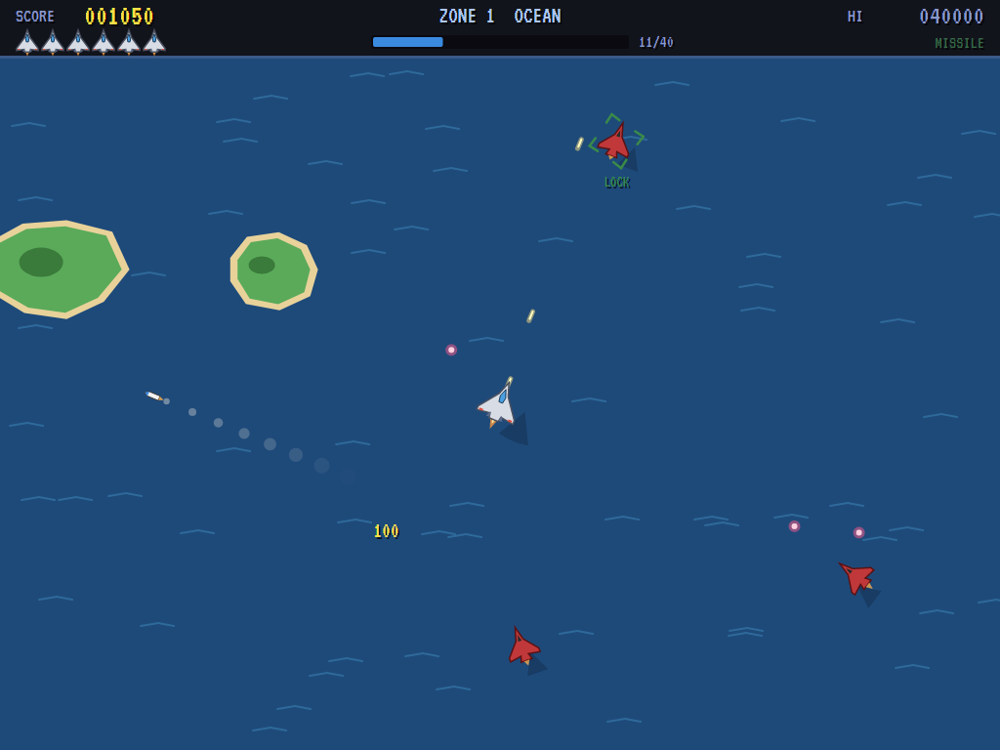
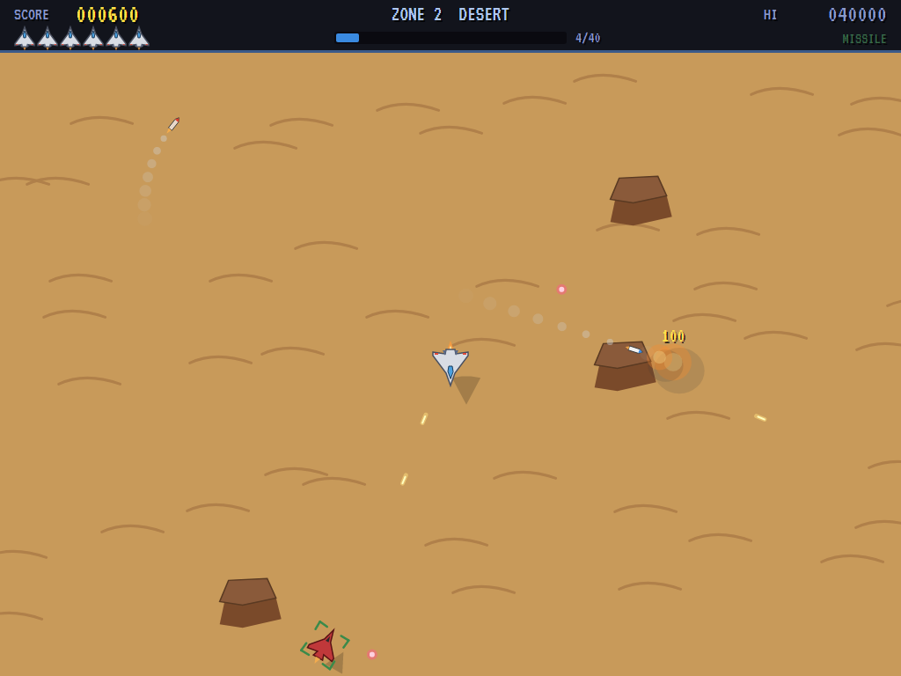
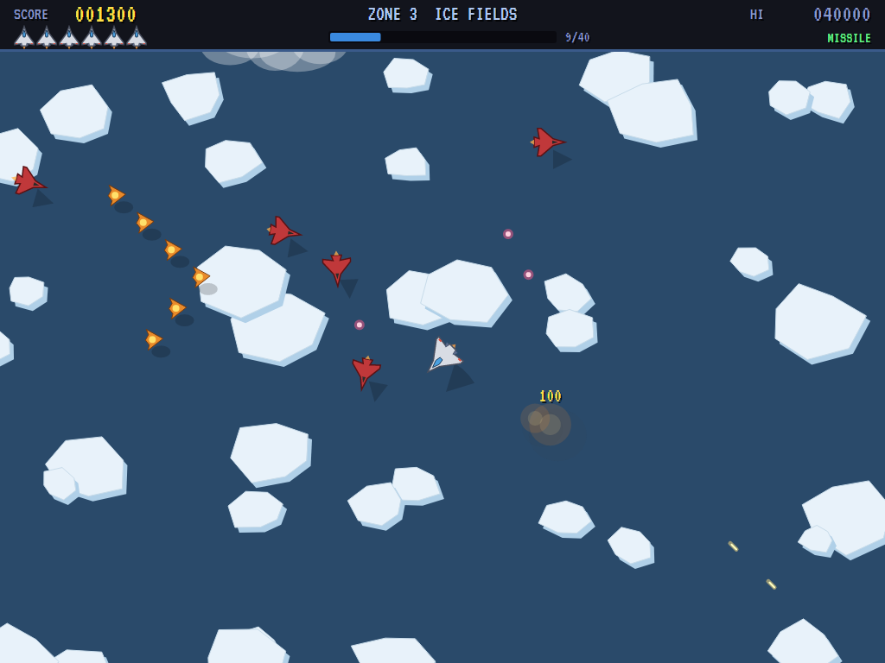
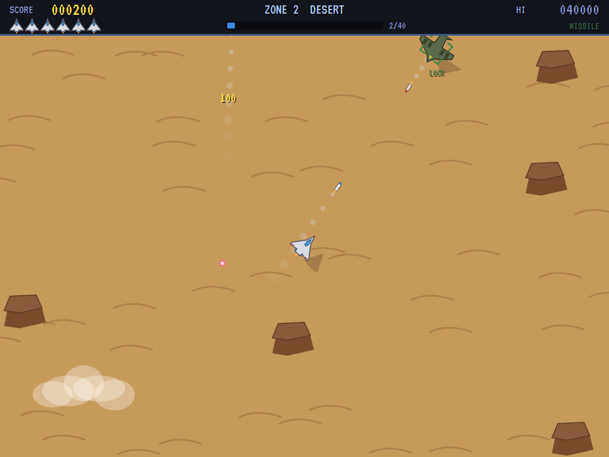
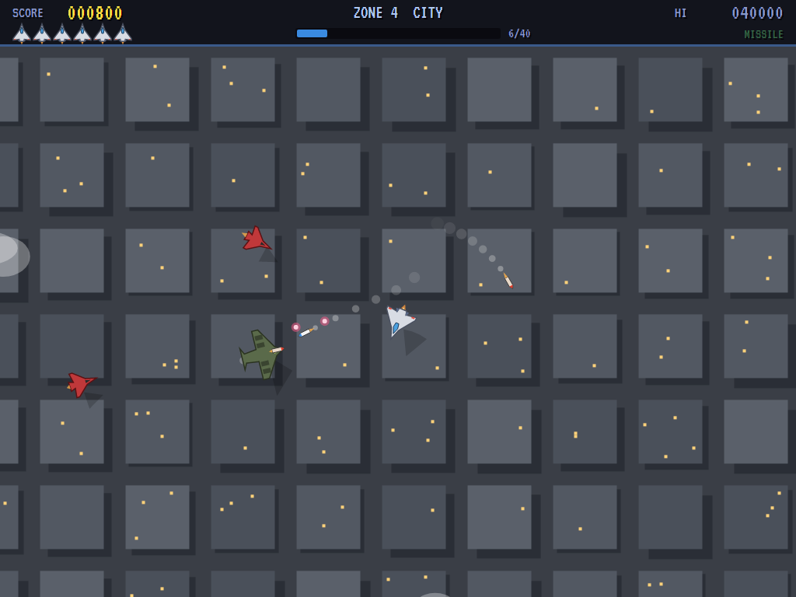
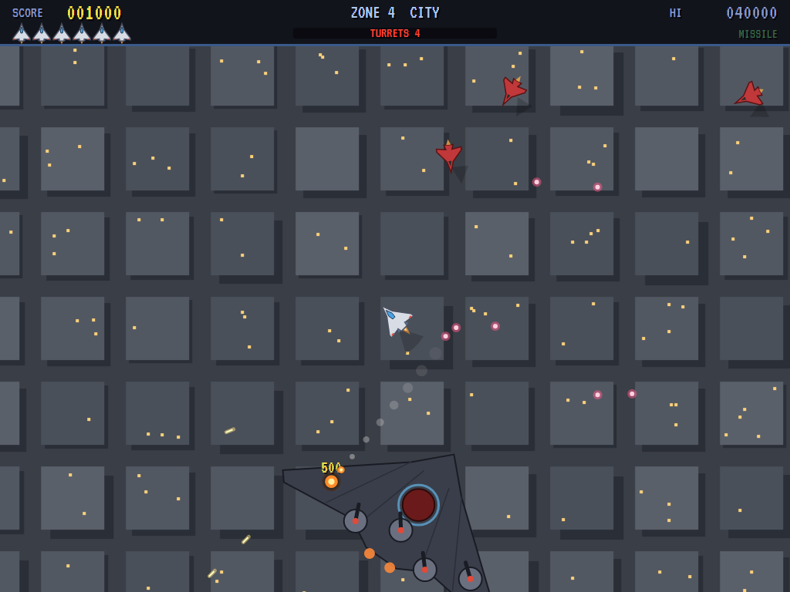
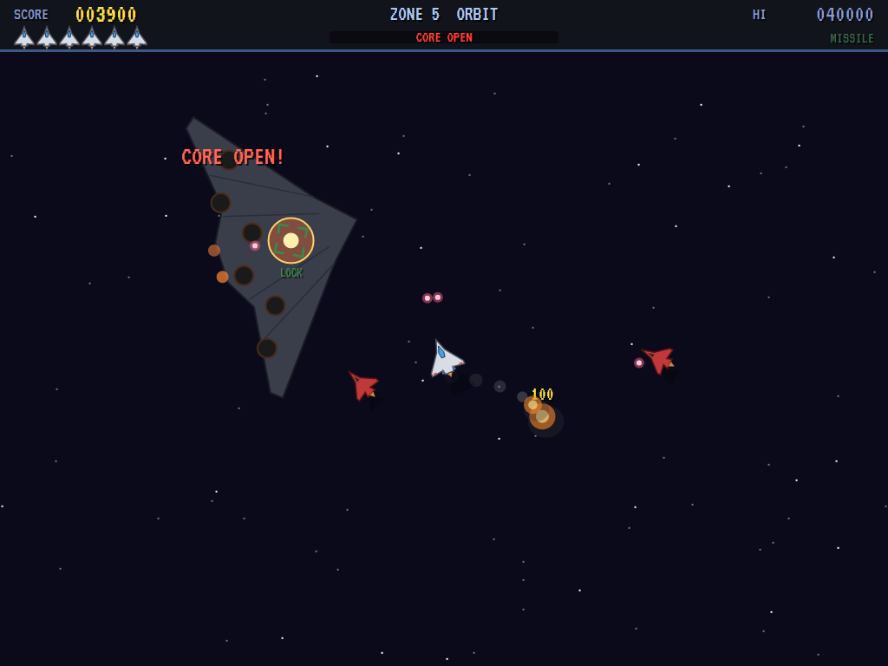
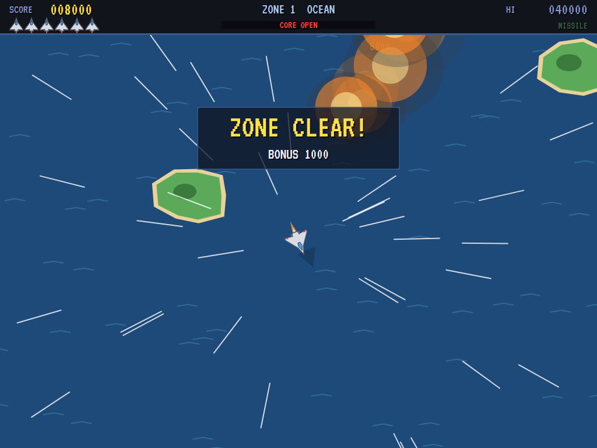

# AVA Time Pilot '84

[](https://github.com/Harlock123/AVATimePilot84/actions/workflows/build.yml)

A free-flying jet dogfight in the style of Konami's 1984 arcade game **Time Pilot '84**, built with .NET 10
and Avalonia UI. Your jet is always in the middle of the screen and never stops flying. The ground below and
the enemy around you wheel past as you turn. You have guns and homing missiles that lock on to whatever is
ahead of your nose. Down forty of the enemy and the zone's carrier comes out: a huge flying wing whose
turrets have to be knocked out before its core can be hit. Bring it down and you're away to the next zone.

It's a companion to [AVA Time Pilot](https://github.com/Harlock123/AVATimePilot), the remake of the 1982
original. This one has jets, missiles, ground below instead of open sky, and a carrier to take apart at the
end of each zone.

## Features

- **Sixteen-way flying**: the stick points the way you want to go, and the jet banks round to it a step at
  a time, the short way round. It never stops, so you fight by turning.
- **Two weapons:**
  - **Guns** fire straight ahead, up to eight bullets in the air. They also shoot down rockets coming at you.
  - **Homing missiles**: brackets close round whatever is nearest your nose and within range. A missile
    fired then chases that target, and hits three times as hard as a bullet. Two can be out at once.
- **The enemy:**
  - **Interceptors** (100) come round onto your tail, make their pass, and swing back for another,
    firing as they come.
  - **Drones** (50) fly through in a V of six. Down the whole formation for 1,000 more.
  - **Gunships** (300), from zone 2, are slow and take three hits. They fire homing rockets (50).
- **The carrier**: once you've downed forty, it comes out. It's a huge dark flying wing that turns slowly
  after you, firing from its turrets and sending out fighters. An arrow at the screen's edge points to it
  when it's out of sight.
  - **Turrets** (500) shield the core. Knock them all out to open it.
  - **The core** (5,000) glows once it's open. It takes a lot of hits, so this is what missiles are for.
  - Bullets fly on over the wing itself. Flying into the carrier is the end of you.
- **Five zones**, each with its own ground and more turrets on its carrier: **Ocean** (waves and islands),
  **Desert** (dunes and mesas), **Ice Fields** (floes), **City** (rooftops), and **Orbit** (stars and
  far planets). Clouds rush by over everything. After the fifth zone they come round again, fiercer: faster
  interceptors, better shots, more gunships.
- **Scoring**: a bonus of 1,000 times the zone number for each carrier downed, and an extra jet every
  30,000.
- **The attract mode** flies itself. The computer pilot picks the enemy it can bring its nose round to
  soonest, leads its shots, and lets a missile go when it has a lock. It goes for a carrier's turrets and
  then its core, keeps clear of the wing, and gets out of the way of bullets, rockets and collisions.
- **The sounds** are all synthesised: the cannon, missile launches, the lock-on tone, explosions, the
  carrier's alarm, and a driving tune over the engine's roar.

## Screenshots

| The title | Ocean | A missile locked on |
|:---------:|:-----:|:-------------------:|
|  |  |  |
| The enemy, and the points. | Interceptors over the islands. | Over the desert. |

| A drone formation | A gunship's rocket | The city |
|:-----------------:|:------------------:|:--------:|
|  |  |  |
| Six in a V over the ice. | Out-turn it or shoot it down. | Rooftops below. |

| The carrier | The core open | Zone clear |
|:-----------:|:-------------:|:----------:|
|  |  |  |
| Taking out its turrets. | Locked on to the core. | Away to the next zone. |

The screenshots are made by the tests, which play the game in a real (headless) window; see
[Tests](#tests).

## Download and run

Ready-to-run builds for Windows, macOS and Linux, on both Intel/AMD and ARM, are on the
[Releases page](https://github.com/Harlock123/AVATimePilot84/releases/tag/latest). **Latest build** is
rebuilt on every push to `main`. Each download is one self-contained executable: no .NET install is
needed.

| Platform | Archive |
|---|---|
| Windows | `AVATimePilot84-win-x64.zip`, `AVATimePilot84-win-x86.zip`, `AVATimePilot84-win-arm64.zip` |
| macOS | `AVATimePilot84-osx-arm64.tar.gz` (Apple silicon), `AVATimePilot84-osx-x64.tar.gz` (Intel) |
| Linux | `AVATimePilot84-linux-x64.tar.gz`, `AVATimePilot84-linux-arm64.tar.gz`, `AVATimePilot84-linux-arm.tar.gz` |

```bash
tar -xzf AVATimePilot84-linux-x64.tar.gz     # or linux-arm64, linux-arm, osx-arm64, osx-x64
./AVATimePilot84
```

On Windows, unzip and run `AVATimePilot84.exe`. On macOS, if Gatekeeper refuses to open it, run
`xattr -d com.apple.quarantine AVATimePilot84` once. Run with `--no-audio` for silence.

**Sound** comes through OpenAL Soft, built in for every platform. In a virtual machine the game
detects it and uses a larger audio buffer, so the sound doesn't break up.

**Gamepads** use SDL2, which is bundled for Windows, macOS and Intel/AMD Linux. ARM Linux builds need it
installed; without it the keyboard still works:

```bash
sudo apt install libsdl2-dev            # Debian / Ubuntu / Raspberry Pi OS
sudo pacman -S --needed sdl2-compat     # Arch / Omarchy
```

## Controls

| Action | Keyboard | Gamepad |
|---|---|---|
| Start | Enter or 1 | Start |
| The way to fly (eight ways; the jet turns sixteen) | Arrow keys (or W A S D) | Left stick / D-pad |
| Guns | Space, Z or Ctrl | A or right trigger |
| Homing missile (at what's locked) | X, C or Shift | B, X or left trigger |
| Pause | P or Esc | Start |
| Quit (while paused) | Esc | Back |
| Sound on/off | M | |
| Screenshot | Ctrl+S (to your Pictures folder) | |

On the high-score table, type your initials, or use up/down and Space, then Enter.

## Tests

```bash
dotnet test AVATimePilot84.slnx
```

The engine has no UI and runs in fixed 60 Hz steps, so it plays the same at any frame rate, and a seed
always plays the same game. The tests check:

- **The jet:** always flying, and turning a step at a time the short way round; the guns, eight in the air
  at most; locking on to what's nearest the nose; missiles chasing their lock, or flying straight without
  one, two out at most
- **The enemy:** an interceptor coming round and its shot bringing the jet down, then back in with the sky
  cleared; flying into an enemy; a gunship's three hits and its homing rockets, and shooting a rocket down;
  a whole formation's bonus
- **The carrier:** coming out at the quota; the core shielded until every turret is out; shots flying on
  over the wing; downing it for the zone bonus and on to the next; flying into it
- **The machine:** the zones in turn and fiercer each time round; extra jets; the last jet lost, and
  initials; the title, demonstration and high scores, and starting a game; the arrow keys pointing the
  right way; the computer pilot taking the first zone, and flying a circle with every gun going losing

The screenshot tests draw the real screen in a headless window. To refresh the README's pictures:

```bash
TIMEPILOT84_SHOTS=$PWD/Images dotnet test tests/AVATimePilot84.Tests --filter ScreenshotTests
```

To see how the computer pilot gets on, zone by zone (`1` for the pilot, `lazy` for one that flies a slow
circle with every gun going):

```bash
TIMEPILOT84_PROBE=1 dotnet test tests/AVATimePilot84.Tests --filter PilotProbe --logger "console;verbosity=detailed"
```

## Building

```bash
dotnet build AVATimePilot84.slnx
dotnet run --project src/AVATimePilot84
```

Needs the .NET 10 SDK. The sounds are made by `tools/make_sounds.py` (standard-library Python):
`python3 tools/make_sounds.py` rewrites `src/AVATimePilot84/Sounds`.

## Project structure

```
AVATimePilot84/
├── AVATimePilot84.slnx
├── src/AVATimePilot84/
│   ├── Engine/
│   │   ├── GameEngine.cs        # States, the title and demo cycle, the music
│   │   ├── GameEngine.Play.cs   # The jet, its guns and missiles, the enemy, the carrier, scoring
│   │   ├── JetPilot.cs          # The computer player, for the demonstration (and the tests)
│   │   ├── Entities.cs          # The jet, the enemy, rockets, the carrier and its turrets, the zones
│   │   ├── Geometry.cs          # Vectors, headings and the field
│   │   ├── HighScoreTable.cs, InitialsEntry.cs
│   │   ├── InputHandler.cs, ControllerManager.cs  # Keys and an SDL2 gamepad
│   │   └── SoundManager.cs      # Effects and the tunes through OpenAL
│   ├── Audio/                   # The OpenAL engine (from the author's AVABand)
│   ├── Views/                   # The drawing: the ground and clouds, the aircraft, the carrier, the screens
│   └── Sounds/                  # The synthesised effects and tunes
├── tests/AVATimePilot84.Tests/  # Gameplay, screenshot and probe tests
├── tools/make_sounds.py
└── Images/                      # Screenshots
```

## About and licence

AVA Time Pilot '84 © 2026 Lonnie Watson, under the [MIT License](LICENSE).

*Time Pilot '84* © 1984 Konami; the name belongs to its current owner. AVA Time Pilot '84 is an
independent, unofficial game in its style. Its jet, enemy, carriers and zones, its graphics, sounds, tunes
and code are its own; nothing is taken from the arcade machine's program, graphics, sound or music. It is
not affiliated with or endorsed by any rights holder.
